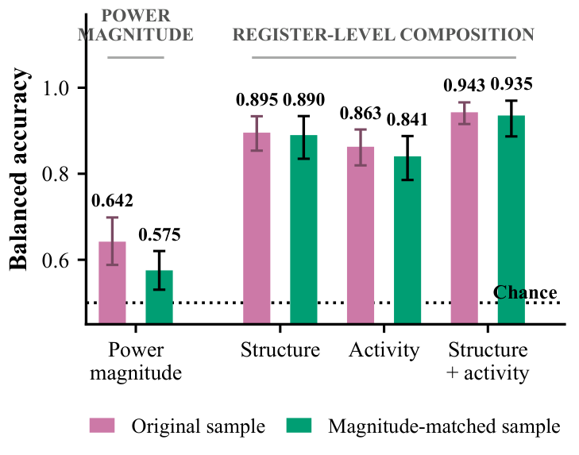
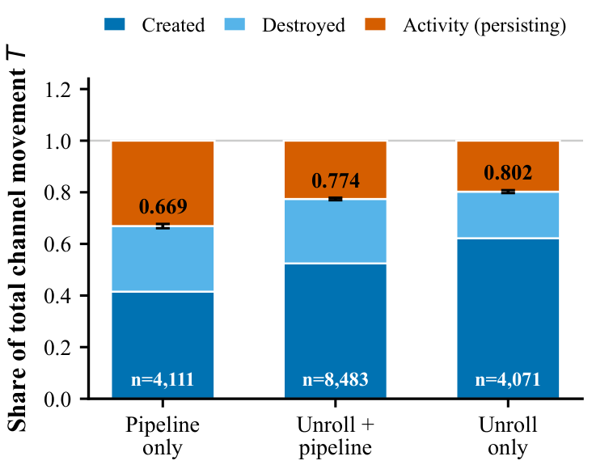
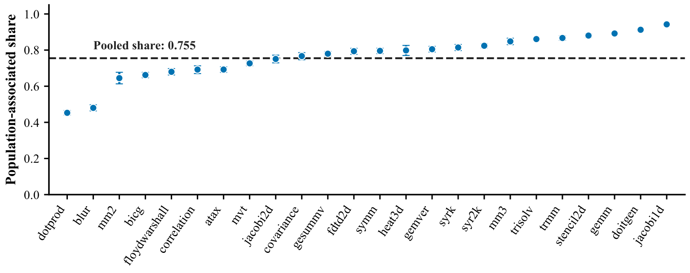
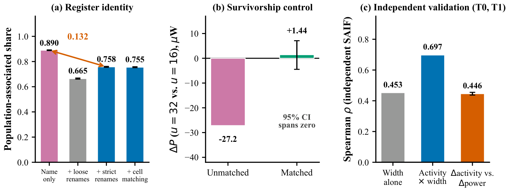
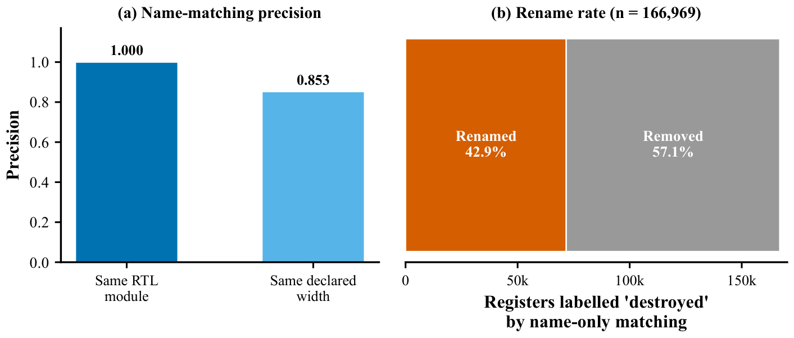
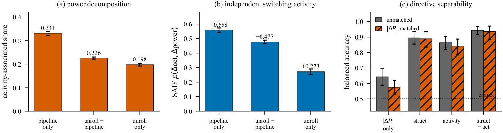
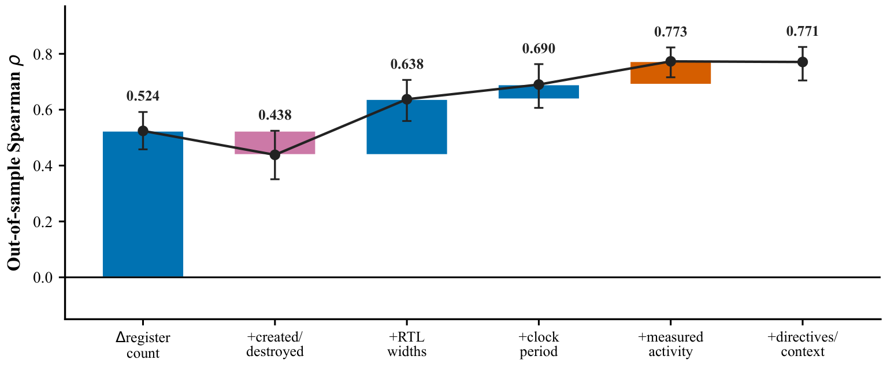
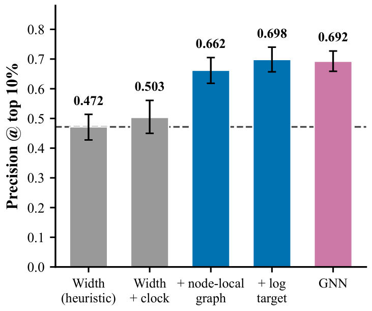

# Beyond Power Change: Register-Level Composition of HLS Transformations

**Authors:** Tushar Dudeja, Abhishek Narayan Tripathi, Vellore Institute of Technology (VIT)
**Tools:** Siemens Catapult HLS, PowerPro, Questa (SAIF), Yosys / OpenROAD / OpenSTA, Python (scikit-learn, LightGBM)

> **Publication status: under review at IEEE.** A manuscript reporting this work by Tushar Dudeja and Abhishek Narayan Tripathi has been submitted to *IEEE Transactions on Computer-Aided Design of Integrated Circuits and Systems (TCAD)* and is currently under peer review.
>
> This work has been submitted to the IEEE for possible publication. Copyright may be transferred without notice, after which this version may no longer be accessible.
>
> The figures, tables and summary results here are shared by the authors under IEEE's policy permitting authors to post their own work on a personal website or public repository. Please cite the published article once it appears; until then, contact the authors before reusing any material.

High-level synthesis (HLS) directives such as loop unrolling and pipelining change a
design's power, but a single number for that change hides *how* the design changed.
This project looks one level down, at the registers: which registers a
transformation keeps, which it creates and which it removes, and how their power
moves.

---

## Data

| | |
|---|---|
| Benchmarks | 25 PolyBench kernels |
| ASIC configurations synthesized | 19,113 (Catapult HLS, Nangate45) |
| Transformation pairs compared | 18,017 |
| Per-register power records | 699,784 (PowerPro), each joined to RTL width/module and simulated switching activity (SAIF) |
| Post-layout check | 65 designs through Yosys / OpenROAD / OpenSTA |

Each pair compares a baseline implementation with a transformed one. Registers are
matched across the pair, so the power change splits into three parts:

**ΔP = A + C − D**, where A is the change on registers present in both designs,
C is the power of registers the transformation **created**, and D is the power of
registers it **destroyed**.

---

## Results

### 1. Register composition tells transformations apart when power cannot

Unroll-only and pipeline-only transformations were matched on the size of their
power change, so the power change itself carries almost no information. A
classifier was then evaluated on held-out kernels:

| Features | Balanced accuracy |
|---|---|
| Signed power change only | 0.575 |
| Six register-composition features | 0.912 |
| Raw structure + activity features | **0.935** |

(4,890 matched observations; chance is 0.5.)



### 2. Most power movement sits in created and destroyed registers

On average, **75.5 %** of the absolute register-power movement is associated with
registers being created or destroyed, and 24.5 % with activity changes on registers
that persist. This share depends on how renamed registers are matched: sweeping the
matching threshold moves it between 72.3 % and 81.7 %, so it is reported together
with that criterion.

| Transformation class | Population share |
|---|---|
| Unroll only (n = 4,071) | 0.802 |
| Pipeline only (n = 4,111) | 0.669 |
| Combined directives (n = 8,483) | 0.774 |




### 3. Independent checks

- **Activity:** switching activity measured separately in Questa (SAIF) tracks the
  power changes on persisting registers: mean within-pair Spearman ρ = 0.446, positive
  in 89.4 % of pairs.
- **Register matching:** recovering renamed registers changes the population share by
  0.132; the controls are shown below.
- **Synthesis failures:** completion rates differ by directive class (0.961 / 0.781 /
  0.310). Restricting to cells where every class completed changes the population
  share by only −0.003, but it reverses a naive "u = 32 vs u = 16" power comparison
  (−27.2 µW unrestricted, +1.44 µW with an interval that spans zero).





### 4. Ranking power changes on unseen kernels

With no feature derived from power, held-out-kernel ranking of power changes reaches
**Spearman 0.773**: register counts alone give 0.524, widths raise it to 0.638,
clock to 0.690 and measured activity to 0.773. Absolute prediction is weaker
(R² = 0.22), as expected for a heavy-tailed target.



### 5. Finding the hottest registers

Within one implementation, netlist-graph features with gradient-boosted trees find
the top 10 % of registers by power with precision 0.662, against 0.472 for ranking by
width; they win in all 25 kernel folds. Summed per design, the predictions correlate
with post-layout sequential power at r = 0.772 over 20 designs.



---

## Repository contents

```
figures/   result figures (PNG, rendered from the vector originals)
results/   summary tables behind the figures (CSV)
```

The raw campaign data (about 3.5 GB), analysis scripts and the manuscript are not
included.

## Limitations

- One HLS tool (Catapult), one library (Nangate45) and one benchmark suite.
- Power is attributed to registers, not caused by them: the split describes where
  power sits, and its value depends on the register-matching rule.
- Post-layout validation covers 20 vector-driven designs at one configuration.

## License

All rights reserved. Shared for reference; contact the authors for reuse.
